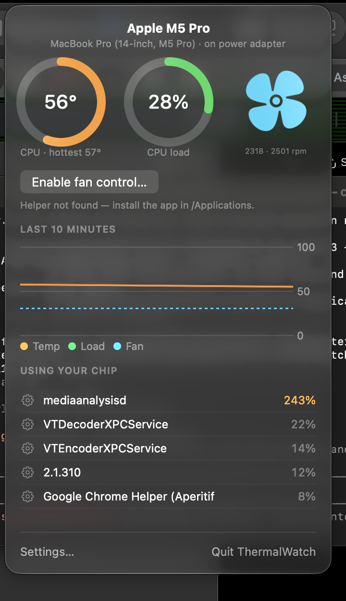

# ThermalWatch

A small macOS menu bar app that shows how hot your Mac is, what the fans are doing, and **why** it's hot. It can also boost the fans safely when you want more cooling.



It was built for one machine, a 14-inch MacBook Pro with an M5 Pro on macOS 27, after it ran hot with a draining battery during app development. The cause was background work, not a lazy fan: Photos analysis, an idle Logic Pro project and a Logitech updater. So the app's main job is to show you what's heating the chip.

## What it does

**Menu bar**
- Shows the CPU temperature (`58°`).
- A setting adds CPU load (`58° · 33%`).

**Popover**
- The chip and model name.
- Animated dials for CPU temperature (with the hottest core) and overall CPU load.
- A fan that spins in proportion to the real fans' RPM.
- A 10-minute graph of temperature, load and fan speed.
- The five processes using the most CPU right now.
- "Busy in the background" warnings for apps that aren't in front and have averaged ≥25% CPU for 10+ minutes, with **Ignore** and (for regular apps) **Quit**.

**Fan boost:** Auto · Medium (60%) · High (80%) · Max.

**Auto-boost (optional):** switches to High after 15 s at or above a temperature you set (default 80°C). It returns to Auto after a minute at 10°C or more below that.

**Settings:**
- CPU load in the menu bar
- °C/°F
- auto-boost and its threshold
- launch at login

**Light on resources:** about 0.2% CPU while the popover is closed.

## Fan safety

Fan writes go through a small root helper, a launchd daemon registered with `SMAppService` that you approve once in System Settings → Login Items. The helper enforces every safety rule itself, so a crashed or killed app can't leave the fans stuck.

**Boost only adds cooling.** The target speed is the highest of:
- the chosen level,
- the RPM when boost started,
- a temperature floor that rises linearly from minimum at 60°C to maximum at 90°C.

If the hottest core reaches 95°C, the fans go straight to Max.

**The fans go back to Auto when:**
- the app quits,
- the app's heartbeat stops for 10 s (crash or `kill -9`),
- the XPC connection drops,
- the Mac is about to sleep,
- the temperature can't be read,
- the helper starts.

**Nothing comes back by itself.** A boost isn't restored after sleep or a timeout.

**Only the real app can connect.** The helper only accepts connections from an app signed with the same Team ID.

Monitoring needs no special rights. Without the helper, everything except boost still works.

## Why it isn't on the App Store

The App Sandbox blocks everything this app is for: reading fan speed and temperatures from the SMC, and listing other processes. Fan writes also need root. The App Store versions of apps like iStat Menus get around this with a separate helper download, so this app is built for direct use instead. It's unsandboxed, uses the hardened runtime, and is signed with a Developer ID or development certificate.

## Build and install

You need Xcode 27+ and [XcodeGen](https://github.com/yonaskolb/XcodeGen) (`brew install xcodegen`).

```sh
make test      # unit tests (Swift Testing); some read real hardware
make install   # Release build → /Applications/ThermalWatch.app (the helper only works from /Applications)
make run
```

**To build it under your own Apple Developer account,** change all three of these:
- `DEVELOPMENT_TEAM` in `project.yml`
- `HelperConstants.teamID` in `Shared/HelperProtocol.swift`
- the `com.jacobtodd` bundle IDs, if you want your own

## Other Macs

The SMC details were checked on an M5 Pro:
- **Manual fan mode** is the lowercase `F0md`/`F1md`. The older `F0Md`/`Ftst` keys don't exist there.
- **CPU temperature** uses the `Tp` and `Tm` sensor families.

Other Apple Silicon Macs may use different keys. `Tools/calibrate-sensors.sh` finds the CPU sensors by loading every core and seeing which sensors heat up. `docs/spike/` has the original probes for reading the fans and test-writing them.

## Project layout

| Path | What's there |
|---|---|
| `App/` | The menu bar app |
| `App/Sampling/` | CPU load, per-process CPU |
| `App/Monitor/` | The sampling loop, history, warnings, formatting |
| `App/Fan/` | Helper client and auto-boost |
| `App/Views/` | SwiftUI |
| `Helper/` | The root launchd daemon (fan writes only) |
| `Shared/` | SMC access, CPU temperature, fan-safety rules, XPC protocol (compiled into both targets) |
| `Tests/` | Unit tests for every decision rule: CPU maths, warnings, auto-boost, fan curve, helper state machine |
| `docs/superpowers/specs/` | The design document, including verified hardware facts and changes made during the build |
| `docs/superpowers/plans/` | The implementation plan |
| `docs/spike/` | The original feasibility probes and the fan-write test log |

## Status

**Built:** monitoring, the popover, warnings, settings and the fan helper.

**Pending:** end-to-end checks of fan boost on the real Mac (manual boost, kill/sleep/quit safety, auto-boost). The fan-safety rules are unit-tested, and fan writes were proven on the M5 Pro during the feasibility spike.

## Disclaimer

This app writes to your Mac's System Management Controller. It's designed to only ever *add* cooling and to hand control back to macOS whenever anything goes wrong, but use it at your own risk.
